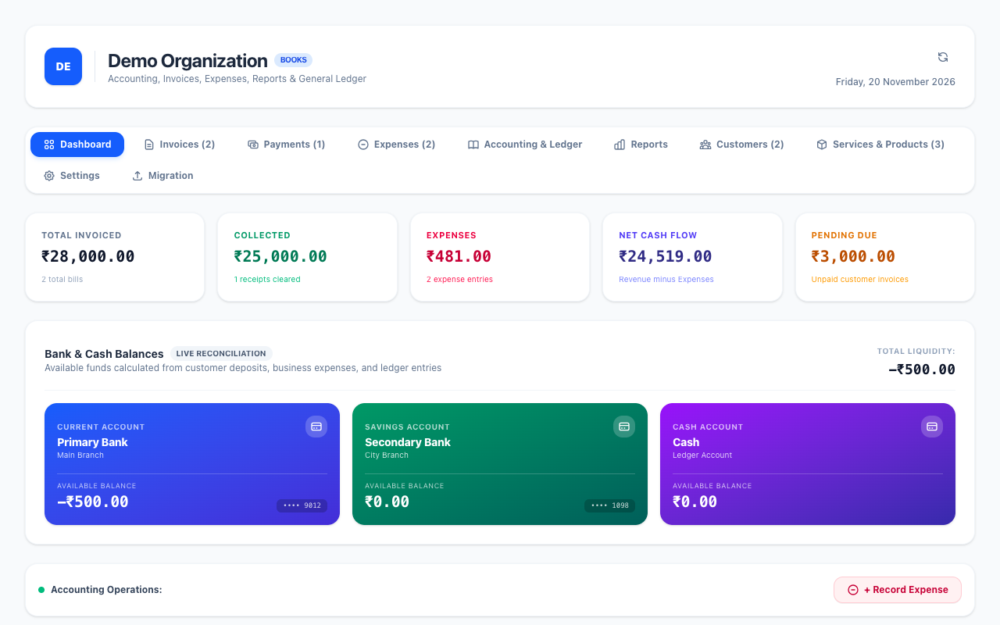
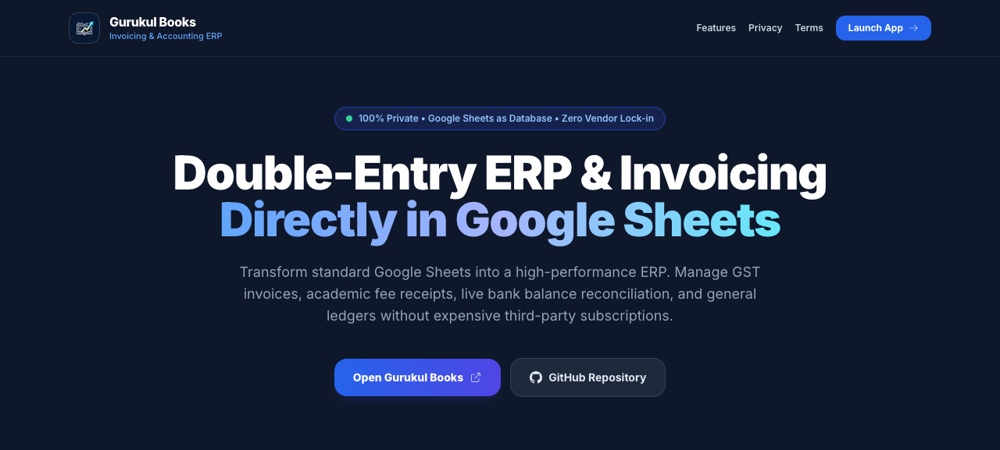
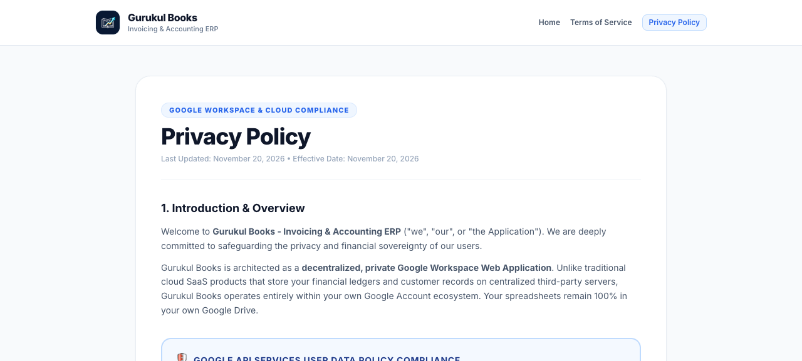
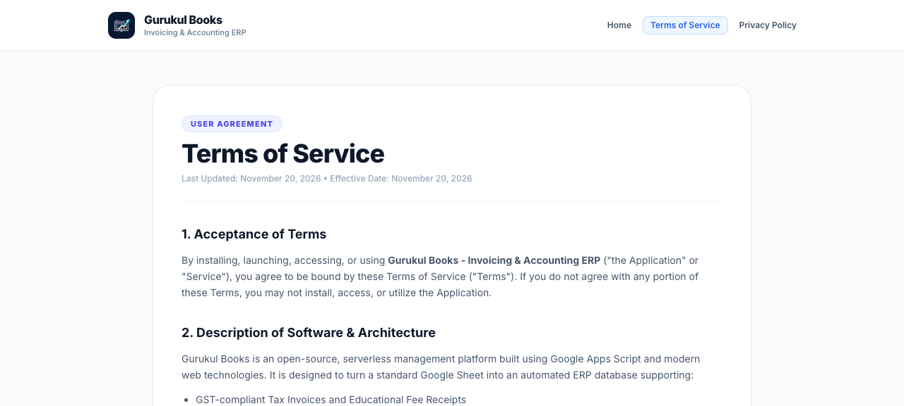

# Marketplace & Documentation Screenshots

All screenshots below were captured automatically using `agent-browser` at standard 1280×800 px resolution and saved in both your artifacts and `docs/assets/` folder.

---

## 1. Application Dashboard (1280×800 px)
> [!TIP]
> This matches the exact Google Workspace Marketplace Store Listing screenshot specification (1280×800 px).

---

## 2. Application Home / Landing Page
*Hosted at `https://sahajananddigital.github.io/Google-Apps-Script-Projects/`*

---

## 3. Google-Compliant Privacy Policy
*Hosted at `https://sahajananddigital.github.io/Google-Apps-Script-Projects/privacy.html`*

---

## 4. Terms of Service
*Hosted at `https://sahajananddigital.github.io/Google-Apps-Script-Projects/terms.html`*

---

## 5. File Locations in Workspace

- **1280×800 Store Screenshot:** [screenshot_dashboard.png](file:///Users/multidots/Documents/Github/Google-Apps-Script-Projects/docs/assets/screenshot_dashboard.png)
- **Landing Page Screenshot:** [screenshot_landing_page.png](file:///Users/multidots/Documents/Github/Google-Apps-Script-Projects/docs/assets/screenshot_landing_page.png)
- **Privacy Policy Screenshot:** [screenshot_privacy_policy.png](file:///Users/multidots/Documents/Github/Google-Apps-Script-Projects/docs/assets/screenshot_privacy_policy.png)
- **Terms of Service Screenshot:** [screenshot_terms_of_service.png](file:///Users/multidots/Documents/Github/Google-Apps-Script-Projects/docs/assets/screenshot_terms_of_service.png)
- **120×120 App Icon:** [app-logo-120x120.png](file:///Users/multidots/Documents/Github/Google-Apps-Script-Projects/docs/assets/app-logo-120x120.png)
